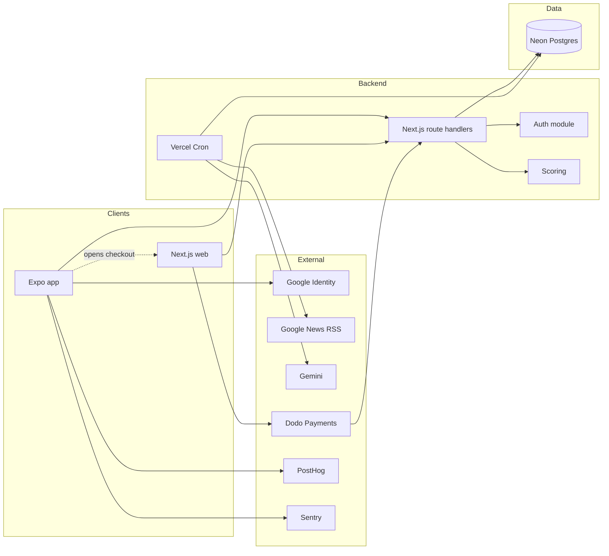

# Etrant mobile architecture

Status: proposed
Last updated: 2026-11-13
Scope: a React Native app for the daily digest, nightly question reels, auth, subscription, and leaderboard.

Related documents:

- `docs/MOBILE_BUILD_PLAN.md` gives the step-by-step build order.
- `docs/MOBILE_SKILLS.md` lists the installed skills.

## 1. Summary

The app has five jobs:

1. Sign in with Google.
2. Read the daily digest.
3. Answer reel-style questions generated from that day's digest.
4. Show the leaderboard.
5. Manage the subscription, which is bought on the website.

The questions are not generated when the user opens the app. A nightly job reads the day's digest, generates a fixed set of questions with Gemini, and stores them in the `questions` table. The app reads them by date range.

Groups, chat, file analysis, on-demand AI question generation, Wikipedia article reels, feedback, and the waitlist stay on the web. The app does not include them.

The app uses the same `user`, `daily_digest`, and `questions` data as the web. It talks to the existing Next.js API and never connects to Postgres directly.

## 2. What the app does

| Feature | What the user sees | Data source |
| --- | --- | --- |
| Google sign in | Welcome screen and Google sign in | `POST /api/auth/mobile/google` |
| Daily digest | The latest day's articles with topic chips, title, summary, and a read link | `GET /api/digest` |
| Digest detail | One article with the full summary, source link, and expandable questions | `GET /api/digest/[id]` |
| Question reels | A full screen pager of multiple-choice questions for a date range | `GET /api/questions?from=&to=` |
| Date range filter | Last 7, 30, 90 days, or a custom start and end date | `GET /api/questions` and `GET /api/questions/dates` |
| Answer scoring | Correct or wrong feedback, explanation, points, streak | `POST /api/questions/attempt` |
| Leaderboard | Top 50 and the current user's rank | `GET /api/leaderboard` |
| Subscription | Plan status and a link to buy or manage on the website | `GET /api/subscription/verify` |
| Profile and settings | Avatar, name, email, plan, points, streak, theme, legal, sign out, delete account | `GET /api/user`, `POST /api/user/update`, `DELETE /api/account` |

## 3. What the app does not do

These stay on the web and are out of scope:

- Study groups and chat.
- File analyzer and file history.
- On-demand AI questions.
- Wikipedia article reels.
- Feedback form and waitlist.
- Interest and language onboarding.
- Push notifications in the first version.

## 4. Technology choices

| Concern | Choice | Why |
| --- | --- | --- |
| Runtime | Expo with development builds | Fast iteration, EAS build and update |
| Language | TypeScript | Same as the web |
| Routing | Expo Router | File-based routes, native stacks and tabs |
| Server state | TanStack Query | Caching, retries, offline reads |
| Client state | Zustand | Theme and small UI state only |
| Styling | StyleSheet with shared tokens | No extra native dependency; matches Expo SDK 58 |
| Lists | FlashList | Smooth full screen paging |
| Images | expo-image | Disk and memory cache |
| Motion | Reanimated and Gesture Handler | Reel transitions and answer feedback |
| Dates | date-fns | Date range labels and formatting |
| Icons | lucide-react-native | Same icon set as the web |
| Auth | Google Sign-In plus app tokens | Same Google account as the web |
| Token storage | expo-secure-store | Refresh token and device id |
| Analytics | PostHog React Native | Same event pipeline as the web |
| Errors | Sentry React Native | Crash and error reports |
| Content | Gemini on the server | The app never calls the model |
| Database | Neon Postgres through the API | The app never connects to the database |

No Pusher, no Dodo SDK, and no RevenueCat in the app. The subscription is bought on the website.

## 5. Repository layout

```text
Etrant/
  app/                         existing Next.js routes
  lib/
    auth/                      new mobile token helpers
    db/                        existing schema
  docs/
    MOBILE_ARCHITECTURE.md
    MOBILE_BUILD_PLAN.md
    MOBILE_SKILLS.md
  mobile/                      new Expo app
    src/
      app/
        _layout.tsx
        index.tsx              auth gate
        (auth)/
          welcome.tsx
          sign-in.tsx
        (tabs)/
          _layout.tsx
          digest.tsx
          questions.tsx
          leaderboard.tsx
          profile.tsx
        digest/
          [id].tsx
        subscription/
          index.tsx
      api/
        client.ts
        auth.ts
        digest.ts
        questions.ts
        leaderboard.ts
        subscription.ts
        user.ts
      auth/
        google.ts
        session.ts
        secure-store.ts
      components/
        ui/
        digest/
        questions/
        leaderboard/
        subscription/
        profile/
      hooks/
      lib/
      providers/
      store/
      theme/
      types/
    assets/
    app.json
    eas.json
    package.json
  packages/
    contracts/                 optional shared Zod schemas
```

## 6. Runtime topology



## 7. Data model

### 7.1 Existing tables used by the app

| Table | Use |
| --- | --- |
| `user` | Profile, plan, subscription flag, points, streak |
| `account` | Google account link |
| `daily_digest` | Daily articles |
| `payments` | Dodo payments from the website |

### 7.2 New tables

`questions`:

```ts
export const questions = pgTable(
  "questions",
  {
    id: text("id")
      .primaryKey()
      .$defaultFn(() => crypto.randomUUID()),
    digestDate: date("digest_date").notNull(),
    position: integer("position").notNull(),
    questionKey: text("question_key").notNull().unique(),
    question: text("question").notNull(),
    difficulty: text("difficulty").notNull(),
    category: text("category").notNull(),
    tags: text("tags").array(),
    context: text("context"),
    estimatedTime: integer("estimated_time"),
    options: jsonb("options").notNull(),
    correctAnswer: integer("correct_answer").notNull(),
    explanation: text("explanation").notNull(),
    metadata: jsonb("metadata"),
    createdAt: timestamp("created_at").defaultNow().notNull(),
  },
  (t) => [index("questions_digest_date_idx").on(t.digestDate)],
);
```

`mobile_refresh_tokens`:

```ts
export const mobileRefreshTokens = pgTable(
  "mobile_refresh_tokens",
  {
    id: text("id")
      .primaryKey()
      .$defaultFn(() => crypto.randomUUID()),
    userId: text("user_id")
      .notNull()
      .references(() => users.id, { onDelete: "cascade" }),
    tokenHash: text("token_hash").notNull().unique(),
    deviceId: text("device_id").notNull(),
    platform: varchar("platform", { length: 16 }).notNull(),
    expiresAt: timestamp("expires_at", { withTimezone: true }).notNull(),
    revokedAt: timestamp("revoked_at", { withTimezone: true }),
    lastUsedAt: timestamp("last_used_at", { withTimezone: true }),
    createdAt: timestamp("created_at", { withTimezone: true })
      .defaultNow()
      .notNull(),
  },
  (t) => [index("mobile_refresh_tokens_user_idx").on(t.userId)],
);
```

`quiz_attempts`:

```ts
export const quizAttempts = pgTable(
  "quiz_attempts",
  {
    id: text("id")
      .primaryKey()
      .$defaultFn(() => crypto.randomUUID()),
    userId: text("user_id")
      .notNull()
      .references(() => users.id, { onDelete: "cascade" }),
    questionId: text("question_id")
      .notNull()
      .references(() => questions.id, { onDelete: "cascade" }),
    selectedIndex: integer("selected_index").notNull(),
    correctIndex: integer("correct_index").notNull(),
    isCorrect: boolean("is_correct").notNull(),
    pointsAwarded: integer("points_awarded").notNull(),
    idempotencyKey: text("idempotency_key").notNull().unique(),
    createdAt: timestamp("created_at").defaultNow().notNull(),
  },
  (t) => [index("quiz_attempts_user_idx").on(t.userId, t.createdAt)],
);
```

### 7.3 Migration

Add the tables to `lib/db/schema.ts`, then run:

```bash
pnpm db:push
```

If Drizzle asks about the existing `daily_points.pois` column, choose the option that keeps your data. The new tables are `questions`, `mobile_refresh_tokens`, and `quiz_attempts`.

## 8. Authentication

### 8.1 Web

Unchanged. NextAuth with Google, Drizzle adapter, session cookie.

### 8.2 Mobile

1. The app opens native Google Sign-In.
2. Google returns an ID token and a nonce.
3. The app posts the token to `POST /api/auth/mobile/google`.
4. The server verifies the token with Google's public keys.
5. The server upserts the `user` and `account` rows.
6. The server returns a 15 minute access token and a 60 day refresh token.
7. The app stores the refresh token and device id in SecureStore.
8. The app sends `Authorization: Bearer <accessToken>` on every API call.
9. On 401, the app calls `POST /api/auth/mobile/refresh` once and retries.
10. On refresh failure, the app clears the session and returns to welcome.

### 8.3 Token format

Access token: JWT signed with `AUTH_SECRET`, HS256, 15 minute expiry.

```ts
type AccessTokenClaims = {
  sub: string;
  email: string | null;
  name: string | null;
  image: string | null;
  typ: "mobile-access";
  iat: number;
  exp: number;
};
```

Refresh token: 32 random bytes, base64url encoded. Store only a SHA-256 hash in the database. Rotate on every use.

### 8.4 Server helpers

```ts
// lib/auth/request-user.ts
export async function getRequestUser(req: Request): Promise<AuthUser | null>;

export async function requireUser(
  req: Request,
): Promise<{ user: AuthUser } | { response: NextResponse }>;
```

`getRequestUser` checks the bearer token first, then falls back to the NextAuth cookie. This lets the same route serve the web and the app.

### 8.5 Account deletion

`DELETE /api/account` deletes the user row and cascades. The app shows a confirmation screen. Apple requires this for apps that create accounts.

## 9. Subscription

### 9.1 What is paid

| Feature | Free | Paid |
| --- | --- | --- |
| Digest list | Yes | Yes |
| Digest detail | Locked | Yes |
| Question reels | Locked | Yes |
| Answer scoring | Locked | Yes |
| Leaderboard | Yes | Yes |
| Profile | Yes | Yes |

This matches the web, where the digest detail and AI practice are paid.

### 9.2 Purchase flow

1. A locked screen or the profile shows "Subscribe on the website".
2. The app opens a sheet:
   - Title: "Subscribe on our website"
   - Body: "Plans and payments are handled on etrant.akkhil.dev. Sign in there with the same Google account you use in this app. After payment, come back and your plan will appear automatically."
   - Primary button: "Open etrant.akkhil.dev"
   - Secondary button: "Not now"
3. The primary button opens `https://etrant.akkhil.dev/subscription?from=app`.
4. The website signs the user in with Google if needed and creates a Dodo checkout.
5. The Dodo webhook writes `users.plan`, `users.subscriptionActive`, and `users.subscriptionEnd`.
6. The success page tells the user to return to the app.
7. The app calls `GET /api/subscription/verify` on return, on foreground, and on pull to refresh.
8. If active, paid features unlock.

### 9.3 Same account rule

The purchase belongs to the `user.id` that created the checkout. The sheet shows the signed-in email so the user can confirm it matches the website account. If the app session is different, the entitlement will not appear. The app offers a sign-in button.

### 9.4 Store policy

Apple Guideline 3.1.1 may reject an iOS app that links to an external purchase page for digital content. This is a product and legal decision. Options:

1. Keep the web handoff and argue the app is a companion to a web service.
2. Add StoreKit later.
3. Make the iOS app read-only for subscriptions.

Record the decision before the first App Store submission.

## 10. Nightly question pipeline

### 10.1 Trigger

The existing Vercel Cron calls `/api/daily-digest` once a day. The route:

1. Fetches the news and generates the digest.
2. Inserts the digest articles.
3. Generates 10 questions from the inserted articles.
4. Inserts the questions into `questions`.

### 10.2 Prompt rules

`lib/prompts/digest-to-questions.ts` enforces:

- Exactly 10 questions.
- Based strictly on the day's digest.
- Four options, exactly one correct.
- `correctAnswer` matches the correct option.
- Medium or hard difficulty.
- Explanation of 20 to 50 words.
- No repeated facts.
- No questions about the source outlet or publication date.
- Valid JSON only, with no markdown.

### 10.3 Idempotency

`question_key` is unique. The insert uses `onConflictDoNothing`. Running the cron twice for the same day does not duplicate questions.

### 10.4 Failure handling

| Failure | Behavior |
| --- | --- |
| News fetch fails | No digest and no questions. |
| No relevant articles | No questions. |
| Digest insert fails for one article | Other articles continue. |
| Question generation fails | The digest is stored. Retry fills the questions. |
| Gemini returns invalid JSON | The digest is stored. Retry fills the questions. |

## 11. API design

| Method | Path | Auth | Purpose |
| --- | --- | --- | --- |
| POST | `/api/auth/mobile/google` | public | Exchange Google ID token for app session |
| POST | `/api/auth/mobile/refresh` | refresh token | Rotate session |
| POST | `/api/auth/mobile/logout` | refresh token | Revoke session |
| GET | `/api/user` | user | Current user and stats |
| GET | `/api/digest` | user | Latest digest day and articles |
| GET | `/api/digest/[id]` | paid user | One digest article with its Q&A |
| GET | `/api/questions?from=&to=&limit=&offset=` | paid user | Questions for a date range |
| GET | `/api/questions/dates?from=&to=` | paid user | Dates that have questions |
| POST | `/api/questions/attempt` | paid user | Score one answer |
| GET | `/api/leaderboard` | user | Top 50 and current rank |
| GET | `/api/subscription/verify` | user | Entitlement status |
| DELETE | `/api/account` | user | Delete account |

The existing `POST /api/questions` remains the web's on-demand AI endpoint. The app uses `GET` only and never calls the model.

### 11.1 Error envelope

```json
{
  "error": "Subscription required.",
  "code": "SUBSCRIPTION_REQUIRED"
}
```

The app maps `UNAUTHORIZED` to the welcome screen, `SUBSCRIPTION_REQUIRED` to the plans screen, and everything else to a readable retry state.

### 11.2 Scoring

`POST /api/questions/attempt`:

```json
{
  "questionId": "uuid",
  "selectedIndex": 2,
  "idempotencyKey": "uuid"
}
```

The server:

1. Checks the user and the subscription.
2. Returns the stored attempt when `idempotencyKey` already exists.
3. Looks up the question.
4. Compares `selectedIndex` with `correctAnswer`.
5. Awards 10 points for correct and 2 for wrong.
6. Inserts a `quiz_attempts` row.
7. Increments `users.points`.
8. Updates `users.streak` and `users.lastActiveDate` on the first attempt of the day.
9. Returns `isCorrect`, `correctIndex`, `explanation`, `pointsAwarded`, and `totalPoints`.

### 11.3 Leaderboard

`GET /api/leaderboard` returns:

```json
{
  "leaderboard": [
    { "id": "user-id", "name": "Name", "image": "https://...", "points": 120, "streak": 4 }
  ],
  "me": { "id": "user-id", "name": "Name", "points": 80, "streak": 2, "rank": 12 }
}
```

The rank is the number of users with more points plus one.

## 12. Mobile app structure

```text
mobile/
  src/
    app/
      _layout.tsx
      index.tsx                   auth gate
      (auth)/
        welcome.tsx
        sign-in.tsx
      (tabs)/
        _layout.tsx               four tabs
        digest.tsx
        questions.tsx
        leaderboard.tsx
        profile.tsx
      digest/
        [id].tsx
      subscription/
        index.tsx
      +not-found.tsx
    api/
      client.ts
      auth.ts
      digest.ts
      questions.ts
      leaderboard.ts
      subscription.ts
      user.ts
    auth/
      google.ts
      session.ts
      secure-store.ts
    components/
      ui/
      digest/
      questions/
      leaderboard/
      subscription/
      profile/
    hooks/
      use-digest.ts
      use-questions.ts
      use-question-dates.ts
      use-leaderboard.ts
      use-subscription.ts
      use-theme.ts
    lib/
      query-client.ts
      query-keys.ts
      errors.ts
      dates.ts
      analytics.ts
      sentry.ts
    providers/
      app-providers.tsx
      query-provider.tsx
      session-provider.tsx
      analytics-provider.tsx
    store/
      session-store.ts
      theme-store.ts
    theme/
      tokens.ts
      theme.ts
    types/
      index.ts
```

## 13. Screens

### 13.1 Auth

- Welcome: product name, one line, "Continue with Google".
- Sign in: Google button, loading state, error state.
- After sign in, the app routes to the digest tab.

### 13.2 Tabs

| Tab | Route | Icon |
| --- | --- | --- |
| Digest | `(tabs)/digest` | `Newspaper` |
| Questions | `(tabs)/questions` | `Brain` |
| Leaderboard | `(tabs)/leaderboard` | `Trophy` |
| Profile | `(tabs)/profile` | `UserRound` |

### 13.3 Digest

- Header: "Daily Digest" and the date.
- Cards with topic chips, title, a summary excerpt, and "Read the digest".
- Pull to refresh.
- Empty state when no digest exists.
- Detail is paid. A free user sees the locked screen with "View plans".

### 13.4 Questions

- Date range control: 7 days, 30 days, 90 days, Custom.
- Custom opens a date range picker. Days without questions are disabled.
- Full screen vertical pager. One question per screen.
- Difficulty badge, tags, and the source date.
- Four answer rows with letter badges.
- Correct answer turns green. Selected wrong answer turns red. Other rows fade.
- Explanation sheet after an answer.
- Confetti on a correct answer and haptics on selection.
- Points chip updates from the server response.
- Paid gate. A free user sees the locked screen.

### 13.5 Leaderboard

- Top 50 by points.
- Row: rank, avatar, name, points, streak.
- Current user row highlighted, with rank even outside the top 50.
- Pull to refresh.
- Empty state.

### 13.6 Profile

- Avatar, name, email, plan badge.
- Points and streak.
- "Manage subscription" opens the plans screen.
- Appearance: system, light, dark.
- Privacy policy, terms, app version.
- Sign out.
- Delete account with confirmation.

### 13.7 Subscription

- Free, Pro, and Max cards with the web feature lists.
- "Subscribe on the website" opens the handoff sheet.
- "Manage plan" opens the website.
- Shows the signed-in email.
- After return, refresh the entitlement.

## 14. Design system

Reuse the web tokens in `src/theme/tokens.ts` and style screens with `StyleSheet`. NativeWind is optional and is not used in v1. This keeps the app compatible with Expo SDK 58 and avoids a styling build step.

| Token | Light | Dark |
| --- | --- | --- |
| background | `hsl(210 40% 98%)` | `hsl(222 47% 6%)` |
| foreground | `hsl(222 47% 11%)` | `hsl(210 40% 98%)` |
| card | `hsl(0 0% 100%)` | `hsl(222 40% 9%)` |
| primary | `hsl(221 83% 53%)` | `hsl(217 91% 60%)` |
| secondary | `hsl(214 32% 95%)` | `hsl(217 33% 15%)` |
| muted foreground | `hsl(215 16% 47%)` | `hsl(215 20% 65%)` |
| border | `hsl(214 32% 91%)` | `hsl(217 33% 18%)` |
| success | `hsl(160 84% 32%)` | `hsl(160 70% 42%)` |
| destructive | `hsl(0 84% 60%)` | `hsl(0 72% 55%)` |
| radius | 10px | 10px |

Typography:

| Role | Font | Size | Weight |
| --- | --- | --- | --- |
| Page title | Inter | 30 | 700 |
| Section title | Inter | 20 | 700 |
| Body | Inter | 15 | 400 |
| Small | Inter | 13 | 400 |
| Long form | Newsreader | 17 | 400, line height 1.75 |
| Numbers | Inter | varies | 600, tabular |

Design direction:

- One accent. Primary blue is the only saturated color in a screen.
- Typography carries hierarchy before borders and boxes.
- No card inside a card.
- One authored motion moment per screen.
- Every state is designed: loading, empty, error, offline, locked, long content.
- Use real digest copy in mockups.
- Icons come from lucide at one stroke weight.
- Touch targets are at least 44 by 44 points.
- Text scales to 200 percent without clipping.
- No gradient text, decorative glass, or hard offset shadows.

Design quality gate:

1. Shape with `impeccable`.
2. Tokens with `better-typography`, `better-colors`, `better-layout`.
3. Platform with `apple-design` and `react-native-design`.
4. Motion with `animate-expo` and `gestures`.
5. Stress with `break-ui`.
6. Review with `interface-review`.
7. Release with `better-accessibility` and `expo-native-ui`.

## 15. State and caching

Query keys:

```ts
export const queryKeys = {
  me: ["me"] as const,
  subscription: ["subscription"] as const,
  digest: ["digest"] as const,
  digestDetail: (id: number) => ["digest", id] as const,
  questions: (from: string, to: string, offset: number) =>
    ["questions", from, to, offset] as const,
  questionDates: (from: string, to: string) =>
    ["question-dates", from, to] as const,
  leaderboard: ["leaderboard"] as const,
};
```

Defaults:

| Data | staleTime | gcTime | Persisted |
| --- | --- | --- | --- |
| Current user | 30 s | 5 min | Yes |
| Subscription | 30 s | 5 min | Yes |
| Digest | 5 min | 1 hour | Yes |
| Digest detail | 30 min | 24 hours | Yes |
| Questions | 5 min | 1 hour | Yes, last 100 |
| Question dates | 30 min | 24 hours | Yes |
| Leaderboard | 1 min | 10 min | Yes |

Offline behavior:

- Serve the last digest, the last question batch, and the last leaderboard from the cache.
- Show an offline banner.
- Retry when the connection returns.
- Answer attempts require a connection. Do not queue them silently.

## 16. Performance budgets

| Metric | Target |
| --- | --- |
| Cold start to interactive | under 2.5 s on a mid-tier Android device |
| Question swipe | 60 fps, no blank frame |
| Digest list scroll | 60 fps with 100 cards |
| Leaderboard scroll | 60 fps with 50 rows |
| Image memory | under 120 MB during a 50 question session |
| Initial JS bundle | under 3 MB compressed |
| API p95 | under 400 ms for reads |

## 17. Security and privacy

- Access tokens last 15 minutes. Refresh tokens are hashed at rest and rotated.
- Store tokens in SecureStore, never AsyncStorage.
- Do not log tokens, emails, or answer payloads.
- The API checks ownership and subscription on every paid route.
- The app never connects to Postgres and never holds a Gemini key.
- Analytics uses anonymous events. Do not send emails.
- Account deletion is available in the app.
- The privacy policy and terms are reachable from the profile.

## 18. Testing

| Layer | Tool | What it covers |
| --- | --- | --- |
| Unit | Jest | Token math, date ranges, formatting, answer selection |
| Component | React Native Testing Library | Digest card, question card, answer states, leaderboard row |
| Contract | Vitest and Zod | API response shapes |
| API | Vitest and a test database | Auth, scoring, date range, subscription gate |
| E2E | Maestro | Sign in, digest, questions, date filter, leaderboard, subscription sheet |
| Manual | Device matrix | iOS 17 and 18, Android 13 to 16, small and large screens |

Maestro flows:

```text
flows/
  auth.yaml
  digest.yaml
  digest-detail.yaml
  questions.yaml
  date-range.yaml
  leaderboard.yaml
  subscription.yaml
  profile.yaml
```

## 19. Build and release

- EAS profiles: `development`, `preview`, `production`.
- EAS Update for JavaScript fixes.
- Store listing with `app-store-optimization`.
- Privacy labels: identifiers, purchases, diagnostics, analytics.
- Review notes: account deletion, the external purchase handoff, and the absence of UGC.
- Decide the App Store external purchase risk before submission.

## 20. Delivery plan

### Phase 0: Backend foundation, 3 to 4 days

- Add `questions`, `mobile_refresh_tokens`, and `quiz_attempts`.
- Add the nightly question generation.
- Add mobile auth endpoints and `requireUser`.
- Add scoring, leaderboard, subscription verify, and account deletion.
- Gate the paid routes.

### Phase 1: App shell and auth, 3 to 4 days

- Scaffold Expo.
- Install dependencies.
- Build the design system and four tabs.
- Build Google sign-in, SecureStore, refresh, and the auth gate.

### Phase 2: Digest, 2 days

- Digest list and detail.
- Paid gate and locked screen.
- Loading, empty, error, and offline states.

### Phase 3: Questions and leaderboard, 4 to 5 days

- Question pager and date range.
- Answer scoring, explanation, confetti, haptics.
- Leaderboard and current rank.

### Phase 4: Subscription and profile, 2 to 3 days

- Plans screen and handoff sheet.
- Entitlement refresh.
- Profile, settings, sign out, delete account.

### Phase 5: Polish, testing, release, 5 days

- Design gate.
- Maestro flows.
- Performance profiling.
- EAS build and store submission.

## 21. Risks and open decisions

| Risk | Impact | Mitigation |
| --- | --- | --- |
| Apple rejects the external purchase link | Subscription cannot launch on iOS as designed | Decide before submission: accept, add StoreKit, or make iOS read-only. |
| Nightly generation fails | The day has no questions | Keep the digest, log the failure, retry the cron, add a health check. |
| Question quality is weak | Users stop trusting the reels | Tight prompt, 10 questions, spot checks, a report action later. |
| Token refresh loop | The app gets stuck | Refresh once per request, clear the session on failure. |
| Date range query is slow | The reel takes long to load | Index on `digest_date`, limit 50 per page, prefetch one page. |
| Points abuse | The leaderboard is meaningless | Server-side scoring with idempotency keys. |
| Time zone drift | Questions land on the wrong date | Generate in IST and store ISO dates. |

Open decisions:

1. Whether the digest list stays free. Recommendation: yes, to match the web.
2. Whether the question archive is paid. Recommendation: yes, to match the web.
3. Whether to add push notifications. Recommendation: defer to version 1.1.
4. Whether to add a report question action. Recommendation: add after launch if users ask.

## 22. Definition of done

- A user can sign in with Google and stay signed in across restarts.
- The digest list and detail work, with the detail gated for paid users.
- The question reels work for 7, 30, 90 day and custom ranges.
- Answers are scored on the server, points and streak update, and the leaderboard matches.
- A website purchase unlocks paid features in the app with the same account.
- The nightly cron inserts 10 questions for the day without duplicates.
- The app works offline with the last cached digest and question batch.
- Account deletion works from the profile.
- The design gate and accessibility checks pass.
- Maestro flows pass on iOS and Android.
- The app is in TestFlight and Play internal testing.
- Crash-free sessions are above 99.5 percent after launch.

## Appendix A. Screen to API map

| Screen | Reads | Writes |
| --- | --- | --- |
| Welcome and sign in | none | `POST /api/auth/mobile/google` |
| Digest tab | `GET /api/digest` | none |
| Digest detail | `GET /api/digest/[id]` | none |
| Questions tab | `GET /api/questions?from=&to=` | `POST /api/questions/attempt` |
| Date range picker | `GET /api/questions/dates` | none |
| Leaderboard | `GET /api/leaderboard` | none |
| Subscription | `GET /api/subscription/verify` | none, opens the website |
| Profile | `GET /api/user` | `DELETE /api/account` |

## Appendix B. Reuse table

| Concern | Web today | Mobile | Reuse |
| --- | --- | --- | --- |
| Language | TypeScript | TypeScript | Yes |
| UI runtime | React 19 | React Native with React 19 | Partial |
| Routing | Next.js App Router | Expo Router | Concept only |
| Styling | Tailwind | NativeWind | Tokens, not classes |
| Server state | TanStack Query | TanStack Query | Yes |
| Client state | Zustand | Zustand | Yes |
| Validation | Zod | Zod | Yes |
| Dates | date-fns | date-fns | Yes |
| Icons | lucide-react | lucide-react-native | Names |
| Database | Drizzle plus Neon | none, API only | Data only |
| Auth | NextAuth cookie | Bearer plus refresh | User table |
| Payments | Dodo | Dodo on the website | Entitlement table |
| AI | Gemini server side | none | API |
| Analytics | PostHog JS | PostHog RN | Events |
| Errors | console plus boundaries | Sentry RN | No |

## Appendix C. What was removed and why

| Removed | Reason |
| --- | --- |
| Groups and chat | Out of scope, and the largest source of complexity and moderation work |
| File analyzer | Out of scope, and it needs upload, parsing, and ownership checks |
| On-demand AI questions | Replaced by the nightly generated question set |
| Wikipedia article reels | Out of scope |
| Feedback and waitlist | Out of scope |
| Interest and language onboarding | The digest and questions are not personalized |
| Push notifications | Deferred to version 1.1 |
